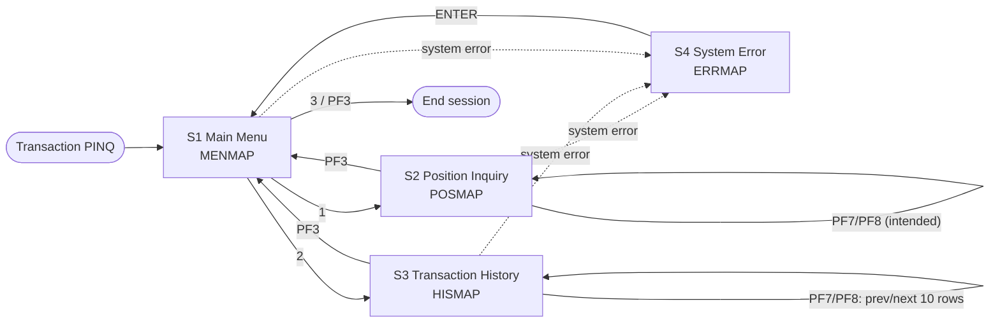

# Portfolio Inquiry Frontend: Functional Requirements (CICS to React)

| | |
|---|---|
| Phase | 1 of 2 (requirements only; phase 2 builds the React app) |
| Source of truth | This repository at commit `c4d72b4` (`main`) |
| Legacy scope | CICS transaction `PINQ`, mapset `INQSET`, programs in `src/programs/online/` |
| Audience | The engineer (human or Devin) who builds the React frontend using only this document and the repo |

> **How to read this document.** Every behaviour is cited as `file:line` against `main`. Where the code is a stub, cannot work as written, or disagrees with the documentation, this is stated as a **GAP** (a numbered entry in [Section 10](#10-open-questions-and-gaps)). The React app should implement the *intended* behaviour described in the FRs, which picks one option for each gap and flags it as an assumption. It should not copy the broken legacy behaviour.

---

## Table of contents

1. [Scope, current-system summary and screen inventory](#1-scope-current-system-summary-and-screen-inventory)
2. [Screen specifications](#2-screen-specifications)
3. [Navigation, flow and state](#3-navigation-flow-and-state)
4. [Business rules and validation](#4-business-rules-and-validation)
5. [Error handling](#5-error-handling)
6. [Security and access behaviour](#6-security-and-access-behaviour)
7. [Data contract: REST API, TypeScript types, mock data](#7-data-contract)
8. [Functional requirements and traceability](#8-functional-requirements)
9. [Modern UX equivalents, non-functional requirements, out of scope](#9-modern-ux-equivalents-nfrs-and-out-of-scope)
10. [Open questions and gaps](#10-open-questions-and-gaps)

---

## 1. Scope, current-system summary and screen inventory

### 1.1 Scope

In scope: the **CICS online inquiry layer**. It is read-only. A user can:

- open a main menu,
- look up the **position(s)** held by an account (current data, VSAM file `POSFILE`),
- look up the **transaction history** for an account (historical data, DB2 table `POSHIST`),
- see system errors,
- exit.

The legacy online layer has **no create, update or delete** functions. The batch programs (`src/programs/batch`, `src/programs/portfolio`) and reports are out of scope (see [9.4](#94-out-of-scope)).

### 1.2 Legacy components

| Component | File | Role, from the code |
|---|---|---|
| Transaction `PINQ` | `src/cics/PORTDFN.csd:6-11` | Entry point. Starts program `INQONLN`. |
| `INQONLN` | `src/programs/online/INQONLN.cbl` | Main controller. Receives a map, dispatches on a 4-character function code, links to `INQPORT`/`INQHIST`, then calls `SECMGR` (`INQONLN.cbl:46-88`). |
| `INQPORT` | `src/programs/online/INQPORT.cbl` | Position inquiry. One keyed `READ` of VSAM `POSFILE`, then `SEND MAP('POSMAP')` (`INQPORT.cbl:68-94`). |
| `INQHIST` | `src/programs/online/INQHIST.cbl` | History inquiry. Connects to DB2 through `DB2ONLN`, runs a cursor through `CURSMGR`, fills a 10-row table, then `SEND MAP('HISMAP')` (`INQHIST.cbl:95-186`). |
| `CURSMGR` | `src/programs/online/CURSMGR.cbl` | DB2 cursor manager (declare/open/fetch/close). **The file is truncated:** it ends at line 91 and fetch/close are never defined (GAP-07). |
| `DB2ONLN` | `src/programs/online/DB2ONLN.cbl` | DB2 connect/disconnect/status with a nominal pool limit of 100 (`DB2ONLN.cbl:18-22`). |
| `DB2RECV` | `src/programs/online/DB2RECV.cbl` | DB2 recovery. Retries the connection 3 times with a 2-second delay, rolls back, or asks `ERRHNDL` about cursor errors (`DB2RECV.cbl:18-22, 62-145`). |
| `SECMGR` | `src/programs/online/SECMGR.cbl` | Validates the user (V), authorizes against `AUTHFILE` (A), writes an audit row to `AUDITLOG` (L) (`SECMGR.cbl:41-135`). |
| `ERRHNDL` | `src/programs/online/ERRHNDL.cbl` | Central error handler. Logs to `ERRLOG`, formats the message, decides the action (`ERRHNDL.cbl:37-118`). |
| Mapset `INQSET` | `src/maps/INQSET.bms` | Four 24x80 maps: `MENMAP`, `POSMAP`, `HISMAP`, `ERRMAP`. |
| COMMAREA | `src/copybook/online/INQCOM.cpy` | Function code, account number, response code, error message. |

### 1.3 Summary of what really happens today

Written as an honest trace, not as the documented intent:

1. `PINQ` starts `INQONLN` (`PORTDFN.csd:6-7`). `INQONLN` loops **conversationally** (`PERFORM ... UNTIL SESSION-TERMINATED`, `INQONLN.cbl:46-48`). It never issues `RETURN TRANSID`, so it is not pseudo-conversational (GAP-03).
2. On every pass it clears the COMMAREA (`INQONLN.cbl:54`), then `RECEIVE MAP('INQMAP')` (`INQONLN.cbl:56-60`). **No map named `INQMAP` exists** in `INQSET` (GAP-01). It then evaluates a field named `WS-COMMAREA-FUNCTION`, which is not declared anywhere: `INQCOM` defines `INQCOM-FUNCTION` (GAP-02).
3. Function `MENU` sends map `INQMNU` (`INQONLN.cbl:92-97`). That map does not exist either: the menu map is `MENMAP` (GAP-01). The menu screen asks for a 1-digit option (1/2/3) (`INQSET.bms:12-18`), but the controller expects 4-character codes `MENU/INQP/INQH/EXIT` (`INQCOM.cpy:5-9`). Nothing translates one into the other (GAP-04).
4. `INQP` links to `INQPORT` (`INQONLN.cbl:101-106`). `INQPORT` reads `POSFILE` keyed by a field `POSITION-ACCOUNT` that does not exist in `POSREC` (`INQPORT.cbl:69-74`, GAP-05). It sends `POSMAP` from the raw record without moving any value into the map's output fields (`INQPORT.cbl:86-92`, GAP-06).
5. `INQH` links to `INQHIST`. `INQHIST` builds a `SELECT ... FROM POSHIST WHERE ACCOUNT_NO = ? ORDER BY TRANS_DATE DESC` (`INQHIST.cbl:130-135`), runs one fetch of at most 10 rows (`INQHIST.cbl:20-26, 164-175`), and sends `HISMAP` from the raw table (`INQHIST.cbl:177-184`). The parameter marker is never bound, two of the selected columns do not exist in `POSHIST`, and `CURSMGR` fetch/close are missing (GAP-07, GAP-08).
6. **After** dispatching, `INQONLN` calls `SECMGR` to validate, authorize (`INQONLN`/`READ`) and audit (`INQONLN.cbl:79-88, 139-171`). So data has already been read and sent before authorization (GAP-12). If security fails, it calls the error routine and `RETURN`s (`INQONLN.cbl:82-88`).
7. Errors go to `ERRHNDL`, which logs and formats a message (`INQONLN.cbl:119-137`). That message is never put on a screen: no program sends `ERRMAP`, and nothing fills `ERRMSG`/`POSMSG`/`HISMSG` (GAP-14).
8. **No program reads the attention identifier** (`EIBAID`/`DFHAID`): grep of `src/` finds no matches. So PF3, PF7, PF8 and ENTER, though printed on the screens (`INQSET.bms:47-48, 83-84, 98-99`), have **no implemented behaviour** (GAP-09).

**Conclusion for the React build:** the BMS maps, copybooks and DB2 DDL are reliable enough to define the screens and data. The control flow in the programs is incomplete and cannot run as written. This document therefore takes navigation and paging from the map labels and the stated intent (docs, comments, field names) and labels each such choice as an assumption.

### 1.4 Screen inventory

| # | Legacy map | Title (BMS `INITIAL`) | Sent by (code) | Purpose | Proposed React route |
|---|---|---|---|---|---|
| S1 | `MENMAP` (`INQSET.bms:7-19`) | "Portfolio Management System" | Nobody: `INQONLN` sends non-existent `INQMNU` (`INQONLN.cbl:93`) | Main menu: choose inquiry or exit | `/` |
| S2 | `POSMAP` (`INQSET.bms:23-49`) | "Portfolio Position Inquiry" | `INQPORT.cbl:87` | Enter an account, view its position(s) | `/positions` and `/positions/:accountNo` |
| S3 | `HISMAP` (`INQSET.bms:53-85`) | "Transaction History Inquiry" | `INQHIST.cbl:178` | Enter an account, view transaction history, 10 rows per page | `/history` and `/history/:accountNo?page=n` |
| S4 | `ERRMAP` (`INQSET.bms:89-99`) | "System Error" | Nobody (GAP-14) | Show error code and details, then continue | Error page/boundary (`/error`) plus inline banners |



---

## 2. Screen specifications

Conventions:
- **I/O**: `In` = user input (`UNPROT`), `Out` = display-only data, `Lbl` = constant text.
- **BMS attributes** are quoted as written. `IC` = initial cursor. `BRT` = bright. `NUM` = numeric-only keyboard lock.
- Mapset defaults: `MODE=INOUT`, `DSATTS=(COLOR,HILIGHT)` (`INQSET.bms:2-3`). All maps are 24x80.
- All message lines (row 23) are `PROT,BRT,COLOR=RED`, length 78.
- "Source" is the copybook or table the value *should* come from. Where the code does not actually move the value, that is noted.

### 2.1 S1: Main Menu (`MENMAP`)

**Purpose.** Entry screen of transaction `PINQ`. Lets the user choose Position Inquiry, Transaction History, or Exit.

| Field | BMS name | Pos (row,col) | Len | I/O | Type / PIC | Validation | Formatting | Source |
|---|---|---|---|---|---|---|---|---|
| Title | (unnamed) | 1,1 | 40 | Lbl | X(40) | n/a | "Portfolio Management System", bright | `INQSET.bms:8-9` |
| Prompt | (unnamed) | 3,1 | 20 | Lbl | X(20) | n/a | "Select Option:" | `INQSET.bms:10-11` |
| Option 1 | (unnamed) | 5,3 | 40 | Lbl | n/a | n/a | "1. Portfolio Position Inquiry" | `INQSET.bms:12-13` |
| Option 2 | (unnamed) | 6,3 | 40 | Lbl | n/a | n/a | "2. Transaction History" | `INQSET.bms:14-15` |
| Option 3 | (unnamed) | 7,3 | 40 | Lbl | n/a | n/a | "3. Exit" | `INQSET.bms:16-17` |
| Option entry | `OPTION` | 9,3 | 1 | In | 9(1) (`NUM`) | Required. Must be 1, 2 or 3. **No validation exists in code** (GAP-04). Legacy `WHEN OTHER` goes to the error routine (`INQONLN.cbl:74-76`). | 1 digit, initial cursor (`IC`) | `INQSET.bms:18`. Maps to `INQCOM-FUNCTION`: 1=`INQP`, 2=`INQH`, 3=`EXIT` (assumed mapping, GAP-04). |
| Message line | `ERRMSG` | 23,1 | 78 | Out | X(78) | n/a | Red, bright | `INQSET.bms:19`. Intended source: `INQCOM-ERROR-MSG` X(80) (`INQCOM.cpy:12`), truncated to 78. Never populated (GAP-14). |

Note: unlike S2/S3/S4, `MENMAP` has **no PF-key legend line**.

### 2.2 S2: Portfolio Position Inquiry (`POSMAP`)

**Purpose.** The user types an account number. The screen shows the current position(s) for that account: fund/investment ID, fund name, units, cost basis and market value.

| Field | BMS name | Pos | Len | I/O | Type / PIC (source) | Validation | Formatting (proposed for React) | Source copybook / table |
|---|---|---|---|---|---|---|---|---|
| Title | (unnamed) | 1,1 | 40 | Lbl | n/a | n/a | "Portfolio Position Inquiry" | `INQSET.bms:24-25` |
| Account label | `ACCTLBL` | 3,1 | 10 | Lbl | n/a | n/a | "Account:" | `INQSET.bms:26-27` |
| Account number | `ACCTIN` | 3,12 | 10 | In | X(10) (`INQCOM-ACCOUNT-NO`, `INQCOM.cpy:10`) | Required. Digits only. 1-10 characters. Not all zeros (BR-01). **No validation in `INQPORT`.** | Left-aligned. Trim. Do not zero-pad unless the backend requires it (Q-01). | `INQCOM.cpy:10`. Attribute is `UNPROT,IC` only (no `NUM`), so the terminal allows any character (`INQSET.bms:28`). |
| Stopper | (unnamed) | 3,23 | 1 | Lbl | n/a | n/a | Ends the input field | `INQSET.bms:29` |
| Fund ID label | `FUNDLBL` | 5,1 | 10 | Lbl | n/a | n/a | "Fund ID:" | `INQSET.bms:31-32` |
| Fund ID | `FUNDOUT` | 5,12 | 6 | Out | X(6) on screen | n/a | Uppercase text | **Conflict:** the screen has 6 characters, matching `POS-FUND-ID X(06)` in the data dictionary (`data-dictionary.md:84`). The code's `POSREC` has `POS-INVESTMENT-ID X(10)` (`POSREC.cpy:10`), and `INVESTMENT_POSITIONS.INVESTMENT_ID CHAR(10)` (`db2-definitions.sql:31`). React should show up to 10 characters (GAP-10). |
| Fund name label | `NAMELBL` | 5,20 | 10 | Lbl | n/a | n/a | "Fund Name:" | `INQSET.bms:34-35` |
| Fund name | `NAMEOUT` | 5,31 | 30 | Out | X(30) | n/a | Text, truncate with ellipsis past 30 | **No source in the repo.** No copybook or table holds a fund/security name (GAP-11). The closest is `PORTFOLIO_MASTER.PORTFOLIO_NAME VARCHAR(50)` (`db2-definitions.sql:15`), which is a portfolio name, not a fund name. |
| Units label | `UNITLBL` | 7,1 | 10 | Lbl | n/a | n/a | "Units:" | `INQSET.bms:37-38` |
| Units | `UNITOUT` | 7,12 | 15 | Out | `POS-QUANTITY PIC S9(11)V9(4) COMP-3` | n/a | Signed decimal, 4 decimal places, thousands separators, right-aligned. Example `1,250.0000`. | `POSREC.cpy:12`. DB2 equivalent `INVESTMENT_POSITIONS.QUANTITY DECIMAL(18,4)` (`db2-definitions.sql:33`). |
| Cost label | `COSTLBL` | 9,1 | 15 | Lbl | n/a | n/a | "Cost Basis:" | `INQSET.bms:40-41` |
| Cost basis | `COSTOUT` | 9,17 | 15 | Out | `POS-COST-BASIS PIC S9(13)V9(2) COMP-3` | n/a | Currency, 2 decimals, thousands separators, negative shown with a minus sign. Example `$187,500.00`. Currency from `POS-CURRENCY` (`POSREC.cpy:15`), default USD. | `POSREC.cpy:13`; `INVESTMENT_POSITIONS.COST_BASIS DECIMAL(18,2)` (`db2-definitions.sql:34`) |
| Value label | `VALLBL` | 11,1 | 15 | Lbl | n/a | n/a | "Market Value:" | `INQSET.bms:43-44` |
| Market value | `VALOUT` | 11,17 | 15 | Out | `POS-MARKET-VALUE PIC S9(13)V9(2) COMP-3` | n/a | Same as cost basis | `POSREC.cpy:14`; `INVESTMENT_POSITIONS.MARKET_VALUE DECIMAL(18,2)` (`db2-definitions.sql:35`) |
| PF legend | (unnamed) | 22,1 | 79 | Lbl | n/a | n/a | "PF3=Exit  PF7=Previous  PF8=Next" | `INQSET.bms:47-48` |
| Message line | `POSMSG` | 23,1 | 78 | Out | X(78) | n/a | Red, bright | `INQSET.bms:49`. Intended values: "Position not found for account" (`INQPORT.cbl:97-98`) and "Error accessing position data" (`INQPORT.cbl:104-105`). Never actually displayed (GAP-14). |

**Data that exists in `POSREC` but is not on the screen** (the React app may show it as extra columns; recommended, see FR-016): `POS-PORTFOLIO-ID X(08)` (`POSREC.cpy:8`), `POS-DATE X(08) YYYYMMDD` (`POSREC.cpy:9`), `POS-CURRENCY X(03)` (`POSREC.cpy:15`), `POS-STATUS X(01)` A=Active/C=Closed/P=Pending (`POSREC.cpy:16-19`), `POS-LAST-MAINT-DATE X(26)` and `POS-LAST-MAINT-USER X(08)` (`POSREC.cpy:21-22`).

**Width note.** A 15-character screen field cannot hold the full range of `S9(13)V99` once edited (13 digits + separators + sign + 2 decimals is more than 15). The legacy program never edits the values at all (GAP-06). The React app must not truncate. It shows the full value.

**Unused code.** `INQPORT` declares label constants (`INQPORT.cbl:29-34`) and `EXEC SQL INCLUDE SQLPOS` (`INQPORT.cbl:20-21`). Neither is used, and `SQLPOS` does not exist in the repo.

### 2.3 S3: Transaction History Inquiry (`HISMAP`)

**Purpose.** The user types an account number. The screen lists that account's transactions, newest first, 10 rows per page.

| Field | BMS name | Pos | Len | I/O | Type / PIC (source) | Validation | Formatting (proposed for React) | Source |
|---|---|---|---|---|---|---|---|---|
| Title | (unnamed) | 1,1 | 40 | Lbl | n/a | n/a | "Transaction History Inquiry" | `INQSET.bms:54-55` |
| Account label | `HISACCT` | 3,1 | 10 | Lbl | n/a | n/a | "Account:" | `INQSET.bms:56-57` |
| Account number | `HISAIN` | 3,12 | 10 | In | X(10) (`INQCOM-ACCOUNT-NO`) | Same as S2 (BR-01) | Same as S2 | `INQSET.bms:58`, `INQCOM.cpy:10` |
| Col header Date | (unnamed) | 5,1 | 10 | Lbl | n/a | n/a | "Date", bright | `INQSET.bms:61-62` |
| Col header Type | (unnamed) | 5,12 | 4 | Lbl | n/a | n/a | "Type" | `INQSET.bms:63-64` |
| Col header Units | (unnamed) | 5,17 | 10 | Lbl | n/a | n/a | "Units" | `INQSET.bms:65-66` |
| Col header Price | (unnamed) | 5,28 | 10 | Lbl | n/a | n/a | "Price" | `INQSET.bms:67-68` |
| Col header Amount | (unnamed) | 5,39 | 12 | Lbl | n/a | n/a | "Amount" | `INQSET.bms:69-70` |
| History rows 1-10 | `ROW1`..`ROW10` | 7..16,1 | 65 each | Out | One 65-character text line per row | n/a | See row columns below | `INQSET.bms:72-81`. Program table `WS-HISTORY-ENTRY OCCURS 10` (`INQHIST.cbl:20-26`). |
| PF legend | (unnamed) | 22,1 | 79 | Lbl | n/a | n/a | "PF3=Exit  PF7=Previous  PF8=Next" | `INQSET.bms:83-84` |
| Message line | `HISMSG` | 23,1 | 78 | Out | X(78) | n/a | Red, bright | `INQSET.bms:85`. Never populated (GAP-14). |

**History row columns** (column positions from the header labels, `INQSET.bms:61-70`):

| Column | Screen cols | Program field (`INQHIST.cbl:22-26`) | Table column (`POSHIST.sql:25-43`) | Mismatch | React formatting |
|---|---|---|---|---|---|
| Date | 1-10 | `WS-TRANS-DATE PIC X(10)` | `TRANS_DATE DATE` | None. DB2 `DATE` as character is `YYYY-MM-DD`, 10 characters. | ISO date `YYYY-MM-DD` (or locale-formatted). Also show `TRANS_TIME` if available (FR-021). |
| Type | 12-15 | `WS-TRANS-TYPE PIC X(4)` | `TRANS_TYPE CHAR(2)` (BU/SL/TR; FE in `TRNREC.cpy:14-18`) | Program has 4 characters, column has 2 | Show the code plus a label: BU=Buy, SL=Sell, TR=Transfer, FE=Fee (`TRNREC.cpy:15-18`, `COMMON.cpy:25-29`) |
| Units | 17-26 | `WS-TRANS-UNITS PIC S9(9)V99 COMP-3` | `QUANTITY DECIMAL(15,3)` (SQL selects non-existent `TRANS_UNITS`, `INQHIST.cbl:130`) | Column name wrong. Program keeps 2 decimals, column has 3. | 3 decimals, signed, thousands separators |
| Price | 28-37 | `WS-TRANS-PRICE PIC S9(9)V99 COMP-3` | `PRICE DECIMAL(15,3)` (SQL selects non-existent `TRANS_PRICE`, `INQHIST.cbl:131`) | Column name wrong. 2 vs 3 decimals. | 3 decimals (do not drop precision), currency symbol optional |
| Amount | 39-50 | `WS-TRANS-AMOUNT PIC S9(9)V99 COMP-3` | `AMOUNT DECIMAL(15,2)` (SQL selects non-existent `TRANS_AMOUNT`, `INQHIST.cbl:131`) | Column name wrong. The program's integer part (9 digits) is shorter than the column's (13 digits). | Currency, 2 decimals, signed |

Sort order: `ORDER BY TRANS_DATE DESC` (`INQHIST.cbl:134`). There is no secondary sort key. Recommend `TRANS_DATE DESC, TRANS_TIME DESC` so the order is stable (FR-022). Primary key is `(ACCOUNT_NO, PORTFOLIO_ID, TRANS_DATE, TRANS_TIME)` (`POSHIST.sql:47-57`).

**Columns available in `POSHIST` but not on screen** (optional extra columns or a row-detail drawer): `PORTFOLIO_ID`, `TRANS_TIME`, `SECURITY_ID`, `FEES`, `TOTAL_AMOUNT`, `COST_BASIS`, `GAIN_LOSS`, `PROCESS_DATE`, `PROCESS_TIME`, `PROGRAM_ID`, `USER_ID`, `AUDIT_TIMESTAMP` (`POSHIST.sql:27-43`; copybook `DBTBLS.cpy:10-28`).

### 2.4 S4: System Error (`ERRMAP`)

**Purpose.** Full-screen display of a system error with an error code and a details line. The user presses ENTER to continue.

| Field | BMS name | Pos | Len | I/O | Type | Formatting | Source |
|---|---|---|---|---|---|---|---|
| Title | (unnamed) | 1,1 | 40 | Lbl | n/a | "System Error", bright | `INQSET.bms:90-91` |
| Code label | `ERRCODE` | 3,1 | 10 | Lbl | n/a | "Error Code:" | `INQSET.bms:92-93` |
| Error code | `ERRCOUT` | 3,12 | 8 | Out | X(8) | Red | `INQSET.bms:94`. Intended source unclear (GAP-15): 8 characters fits `ERRLOG.ERROR_CODE CHAR(8)` (`ERRLOG.sql:20`) or `ERR-PROGRAM X(8)` (`ERRHND.cpy:5`). Proposed: the API `code` field. |
| Details label | `ERRDESC` | 5,1 | 10 | Lbl | n/a | "Details:" | `INQSET.bms:95-96` |
| Details | `ERRDOUT` | 5,12 | 65 | Out | X(65) | Red | `INQSET.bms:97`. Intended source: `ERR-MESSAGE X(80)` after `ERRHNDL` formats it as `Error in <program> - <message> (<traceId>)` (`ERRHNDL.cbl:92-100`). 80 characters do not fit in 65 (GAP-15). |
| Prompt | (unnamed) | 22,1 | 79 | Lbl | n/a | "Press ENTER to continue" | `INQSET.bms:98-99` |

**Fact:** no program sends `ERRMAP` (grep of `src/` matches only its definition at `INQSET.bms:89`).

---

## 3. Navigation, flow and state

### 3.1 Menu options

| Option (`OPTION`) | Intended function code (`INQCOM-FUNCTION`, `INQCOM.cpy:5-9`) | Legacy action | React action |
|---|---|---|---|
| 1 | `INQP` | `LINK INQPORT` (`INQONLN.cbl:66-67, 101-106`) | Go to `/positions` |
| 2 | `INQH` | `LINK INQHIST` (`INQONLN.cbl:69-70, 110-115`) | Go to `/history` |
| 3 | `EXIT` | `SET SESSION-TERMINATED`, loop ends, `EXEC CICS RETURN` (`INQONLN.cbl:72-73, 50-51`) | End the session: clear state, sign out or return to the launcher (Q-06) |
| anything else | n/a | `WHEN OTHER` goes to `P900-ERROR-ROUTINE` (`INQONLN.cbl:74-76`) | Inline validation message "Select option 1, 2 or 3" (no legacy text exists, GAP-04) |
| (none, initial entry) | `MENU` | `SEND MAP('INQMNU')` (`INQONLN.cbl:63-64, 92-97`). Map name is wrong (GAP-01). | Render the menu at `/` |

### 3.2 PF keys and ENTER

**Legacy fact:** no program tests `EIBAID`, so none of these keys does anything in the code (GAP-09). The intended meaning below comes from the on-screen legends (`INQSET.bms:47-48, 83-84, 98-99`).

| Key | Screen | Intended legacy meaning | React equivalent |
|---|---|---|---|
| ENTER | S1 | Submit the option | "Go" button / Enter key submits the menu form. Menu items are also directly clickable links. |
| ENTER | S2, S3 | Submit the account number and run the inquiry | "Search" button / Enter submits the form |
| ENTER | S4 | "Press ENTER to continue": return to the menu | "Continue" button, focused by default, goes to `/` |
| PF3 | S2, S3 | "Exit": back to the menu (standard CICS convention; the label says Exit) | "Back to menu" link/button plus breadcrumb. Keyboard shortcut `Esc` or `Alt+3` (optional). Browser Back must also work. |
| PF3 | S1 | Not shown on `MENMAP` | n/a (use menu option 3) |
| PF7 | S3 | "Previous": previous 10 history rows | "Previous" pagination button, disabled on page 1. Keyboard `PageUp` (optional). |
| PF8 | S3 | "Next": next 10 history rows | "Next" pagination button, disabled on the last page. Keyboard `PageDown` (optional). |
| PF7/PF8 | S2 | "Previous/Next" position. `INQPORT` reads only one record (`INQPORT.cbl:72-76`), and the file allows browse (`PORTDFN.csd:73`). | Show all positions for the account in a table (FR-014). Paginate at 10 per page only if there are more than 10. |
| CLEAR / PA keys | all | Not handled | n/a |

### 3.3 Paging rules

- **History page size = 10.** Source: `OCCURS 10` (`INQHIST.cbl:21`) and `ROW1`..`ROW10` (`INQSET.bms:71-81`). Note `CURSMGR` has `WS-MAX-ROWS VALUE 20` (`CURSMGR.cbl:24`) for array fetch. That is a fetch buffer size, not a page size. Use 10.
- **Legacy reality:** `INQHIST` fetches once and always shows the first (up to) 10 rows. No paging position (key or offset) is kept anywhere (GAP-09).
- **React rule:** server-side pagination with `page` (1-based) and `pageSize` (default 10, fixed in the UI). The response carries `totalCount` (or `hasNext`). Page 1 is the newest transactions. "Next" goes to older rows.
- On a new account search, reset to page 1.
- Fewer than 10 rows: show only the rows returned. Do not pad the table with empty rows.

### 3.4 State carried across screens (COMMAREA to React state)

Legacy COMMAREA `INQCOM-AREA` (`INQCOM.cpy:4-12`), 98 bytes:

| Field | PIC | Meaning | Legacy reality | React state |
|---|---|---|---|---|
| `INQCOM-FUNCTION` | X(4) | `MENU` / `INQP` / `INQH` / `EXIT` | Cleared to LOW-VALUES on every loop (`INQONLN.cbl:54`) | Current route |
| `INQCOM-ACCOUNT-NO` | X(10) | Account being inquired on | Never moved from a map field into the COMMAREA (GAP-02, GAP-05) | `selectedAccountNo` in the URL path param (shareable, survives refresh) plus app context. **Carry it between S2 and S3** so switching inquiry keeps the account (FR-008). |
| `INQCOM-RESPONSE-CODE` | S9(8) COMP | Last response code | Set by `INQPORT`/`INQHIST` error paths (`INQPORT.cbl:106-107`, `INQHIST.cbl:189-190`). Never read by `INQONLN`. | Part of the API error object (`ApiError.legacyCode`) |
| `INQCOM-ERROR-MSG` | X(80) | Message for the user | Set by `INQPORT` (`INQPORT.cbl:97-98, 104-105`) and `INQHIST` (`INQHIST.cbl:117-118`). Never displayed. | Message banner text |

Other state the React app needs that the legacy code keeps implicitly:
- History `page` (URL query `?page=n`).
- Authenticated user identity (legacy: `EXEC CICS ASSIGN USERID`, `INQONLN.cbl:142-144`).
- Last error `traceId` (legacy `ERR-TRACE-ID`, `ERRHND.cpy:20`), shown to the user for support.

---

## 4. Business rules and validation

| ID | Rule | Legacy evidence | Status in code | React requirement |
|---|---|---|---|---|
| BR-01 | **Account number format.** | Map input is 10 characters, no `NUM` (`INQSET.bms:28, 58`). COMMAREA `X(10)` (`INQCOM.cpy:10`). `PORTVALD` comment: "Account number must be 10 numeric digits"; check: `NOT NUMERIC OR = ZEROS` (`PORTVALD.cbl:73-86`). Message "Invalid Account Number format" (`PORTVAL.cpy:24-25`). Conflicts: data dictionary says numeric 9, range 100000000-999999999 (`data-dictionary.md:24`). `POSHIST.ACCOUNT_NO CHAR(8)` (`POSHIST.sql:26`). `PORT-ACCOUNT-NO X(10)` (`PORTFLIO.cpy:14`). | Not called by any online program. Also, `PORTVALD` checks a 50-character field, so a 10-digit value padded with spaces would fail `NUMERIC` (bug). | Client-side: required, trimmed, `^[0-9]{1,10}$`, not all zeros. Message: "Invalid Account Number format". The backend re-validates. Exact length is Q-01. |
| BR-02 | **Position lookup is by account.** | `READ FILE('POSFILE') RIDFLD(POSITION-ACCOUNT)` (`INQPORT.cbl:72-76`) | Key field does not exist. The real `POSREC` key is portfolio ID + date + investment ID (`POSREC.cpy:7-10`) (GAP-05). | The API resolves account to portfolio(s) to positions. Return all positions for the account (latest `POS-DATE` per investment). |
| BR-03 | **Position not found.** | `RESP NOT NORMAL` sets `NO-POSITION` and the message "Position not found for account" (`INQPORT.cbl:78-82, 96-99`) | Message set but never shown (GAP-14) | Show an empty state with the text "Position not found for account" (keep the legacy wording). HTTP 404 `POSITION_NOT_FOUND`. |
| BR-04 | **Position read error.** | `HANDLE CONDITION ERROR` sends control to "Error accessing position data" plus the response code (`INQPORT.cbl:61-64, 103-108`) | Because `READ` uses `RESP`, `HANDLE CONDITION` is suppressed for that command. The error path is effectively unreachable. Any non-NORMAL response is treated as not-found (`INQPORT.cbl:78-82`). | Distinguish not found (404) from errors (5xx). On 5xx show "Error accessing position data" with the trace ID. |
| BR-05 | **History ordering.** | `ORDER BY TRANS_DATE DESC` (`INQHIST.cbl:134`) | Statement never runs successfully (GAP-07/08) | Newest first. Tie-break by `TRANS_TIME DESC`. |
| BR-06 | **History page size 10.** | `OCCURS 10` (`INQHIST.cbl:21`), `ROW1-10` (`INQSET.bms:72-81`) | Only the first fetch is shown | 10 rows per page |
| BR-07 | **Empty history.** | No branch for SQLCODE +100 or zero rows. `CURS-RESPONSE-CODE >= 0` copies the data area whatever its content (`INQHIST.cbl:171-173`). | Not handled. Would show garbage or blank rows. | Empty state "No transactions found for account" (new text, GAP-13). HTTP 200 with `items: []`, not 404. |
| BR-08 | **Transaction type codes.** | `BU`/`SL`/`TR`/`FE` (`TRNREC.cpy:14-18`, `COMMON.cpy:25-29`, `db2-definitions.sql:102-103`). `POSHIST` comment lists only BU/SL/TR (`POSHIST.sql:80-81`). Test data uses `B`/`S` (`test-data-specs.md:31, 107-112`). Data dictionary uses `BY` (`data-dictionary.md:57`). | Inconsistent across sources | Display labels: BU Buy, SL Sell, TR Transfer, FE Fee. Show any unknown code as-is (raw). |
| BR-09 | **Decimal precision is preserved.** | COMP-3 fields: quantity 4dp (`POSREC.cpy:12`); money 2dp (`POSREC.cpy:13-14`); `POSHIST` quantity/price 3dp (`POSHIST.sql:32-33`) | n/a | Money and quantities travel as **strings** in JSON (see 7.2) and are formatted without floating-point rounding. |
| BR-10 | **Read-only.** | `POSFILE` `UPDATE(NO) DELETE(NO)` (`PORTDFN.csd:74-76`). `SECMGR` authorizes `READ` (`INQONLN.cbl:154`). Note: `ADD(YES)` is also set (`PORTDFN.csd:72`), with no online program writing to it. | n/a | No mutating UI controls |
| BR-11 | **Position status.** | `POS-STATUS` A/C/P (`POSREC.cpy:16-19`) | Not displayed | Show a status badge. Closed positions are shown but visually de-emphasised (Q-04). |
| BR-12 | **Inquiry authorization.** | `SECMGR` authorize `INQONLN`/`READ` against `AUTHFILE` (`INQONLN.cbl:151-159`, `SECMGR.cbl:78-103`) | Runs **after** the data is displayed (GAP-12) | Check authorization before rendering any data (Section 6) |

---

## 5. Error handling

### 5.1 Error sources and what the user sees

| # | Origin | Condition | Code / value | Message text (exact, from code) | Where set | What the user sees today | React behaviour |
|---|---|---|---|---|---|---|---|
| E-01 | `INQPORT` | VSAM `READ` not NORMAL | `NO-POSITION` | "Position not found for account" | `INQPORT.cbl:78-82, 97-98` | Nothing. Message stored in COMMAREA only. | Empty-state panel on S2 with this text (404 `POSITION_NOT_FOUND`) |
| E-02 | `INQPORT` | CICS `ERROR` condition | `INQCOM-RESPONSE-CODE` = `WS-RESPONSE-CODE` | "Error accessing position data" | `INQPORT.cbl:103-108` | Nothing | Red banner on S2 with this text plus trace ID (500 `POSITION_READ_ERROR`) |
| E-03 | `DB2ONLN` | Pool full | `DB2-RESPONSE-CODE = -1` | "Maximum connections reached" | `DB2ONLN.cbl:55-62` | Nothing | 503 `DB_UNAVAILABLE`: "History is temporarily unavailable. Try again." with a Retry button |
| E-04 | `DB2ONLN` | `CONNECT` failed | `-1`, `DB2-SQLCODE` = SQLCODE, msg = `SQLERRMC` | DB2 `SQLERRMC` text | `DB2ONLN.cbl:66-79` | Nothing | Same as E-03 |
| E-05 | `DB2RECV` | Reconnect fails 3 times (2s apart) | `RECV-FAILED`, `-1` | `RECV-MESSAGE` (empty on this path) | `DB2RECV.cbl:62-83`. Copied to `INQCOM-ERROR-MSG` by `INQHIST.cbl:116-120`. | Nothing | Same as E-03. Retrying is the backend's job. The UI must not loop. |
| E-06 | `INQHIST` | Any CICS `ERROR` | `INQCOM-RESPONSE-CODE` = `SQLCODE` | none | `INQHIST.cbl:86-88, 188-191` | Nothing | 500 `HISTORY_READ_ERROR`: "Error accessing transaction history" (new text, GAP-13) |
| E-07 | `CURSMGR` | Declare/open SQL error | `CURS-RESPONSE-CODE` = SQLCODE | none | `CURSMGR.cbl:74-76, 86-90` | Nothing. `INQHIST` still sends the map (`INQHIST.cbl:143-160, 76`). | Same as E-06 |
| E-08 | `INQHIST` | Zero rows | n/a | none | not handled (`INQHIST.cbl:171-173`) | Blank or garbage rows | Empty state "No transactions found for account" (200, empty list) |
| E-09 | `SECMGR` V | `ASSIGN` user differs from supplied | 8 | "User validation failed" | `SECMGR.cbl:62-69` | Error routine, then `RETURN` (`INQONLN.cbl:82-88`) | 401: redirect to sign-in |
| E-10 | `SECMGR` V | `ASSIGN` failed | 12 | "Unable to obtain user credentials" | `SECMGR.cbl:70-74` | Same | 401: redirect to sign-in |
| E-11 | `SECMGR` A | `AUTHFILE` count = 0 | 8 | "Access denied" | `SECMGR.cbl:88-96` | Same | 403 page "Access denied". No data is fetched or shown. |
| E-12 | `SECMGR` A | SQL error | 12 | "Authorization check failed" | `SECMGR.cbl:97-100` | Same | 503 "Authorization check failed. Try again later." |
| E-13 | `SECMGR` L | Audit insert failed | 12 | "Audit logging failed" | `SECMGR.cbl:127-133` | Same. The user is kicked out **after** seeing data. | Server-side concern. If the backend fails closed, the UI shows a 503 with this text. |
| E-14 | `INQONLN` | Unknown function / CICS ERROR / PGMIDERR / NOTFND | `ERR-SEVERITY = 'W'` | `ERR-MESSAGE` formatted by ERRHNDL: `Error in INQONLN - <msg> (<traceId>)` | `INQONLN.cbl:40-44, 119-137`; `ERRHNDL.cbl:92-100` | Nothing. The message goes to the undeclared `WS-ERROR-MESSAGE`. | S4 error screen (or banner) with code plus details plus trace ID |
| E-15 | `ERRHNDL` | `ERRLOG` insert fails | sets `ERR-FATAL`, then action `A` | "Error logging failed" | `ERRHNDL.cbl:85-88, 104-107` | `INQONLN` issues `ABEND ABCODE('IERR')` (`INQONLN.cbl:131-133`). The terminal shows a CICS abend. | S4 full-page error "A system error occurred" with trace ID. The app does not crash (React error boundary). |
| E-16 | CICS | `ERRHNDL` not defined in CSD | PGMIDERR | n/a | `PORTDFN.csd:14-61` lists 7 programs and omits `ERRHNDL` | `LINK ERRHNDL` would raise PGMIDERR, which re-enters `P900` (`INQONLN.cbl:42`) and can loop | n/a (deployment gap, GAP-16) |

### 5.2 ERRHNDL contract (online error copybook `ERRHND`)

`ERRHND.cpy:4-21`: `ERR-PROGRAM X(8)`, `ERR-PARAGRAPH X(30)`, `ERR-SQLCODE S9(9) COMP`, `ERR-CICS-RESP`/`RESP2 S9(8) COMP`, `ERR-SEVERITY X` (F/W/I), `ERR-MESSAGE X(80)`, `ERR-ACTION X` (R/C/A), `ERR-TRACE-ID X(16)`, `ERR-TIMESTAMP X(26)`.

Processing (`ERRHNDL.cbl:37-118`):
1. Timestamp = `FUNCTION CURRENT-DATE`. If the trace ID is blank, it is set from `FUNCTION RANDOM` (`ERRHNDL.cbl:52-61`). This puts a numeric random value into X(16): not a reliable unique ID.
2. Insert into `ERRLOG` (`ERRHNDL.cbl:63-90`). **The column list does not match `ERRLOG.sql:15-25`**: the code writes 8 values (timestamp, program, paragraph, sqlcode, cics resp, severity, message, trace); the table has 10 different columns (GAP-17).
3. Format: `Error in <ERR-PROGRAM> - <ERR-MESSAGE> (<ERR-TRACE-ID>)` into `ERR-MESSAGE` (`ERRHNDL.cbl:92-100`). Source and target overlap (undefined behaviour). The result is cut at 80 characters.
4. Action mapping (`ERRHNDL.cbl:104-114`):

| Severity | Action | Meaning for UI |
|---|---|---|
| `F` Fatal | `A` Abend | Full-page error (S4). Session cannot continue on the current screen. |
| `W` Warning | `C` Continue | Inline banner. The user stays on the screen. |
| `I` Info | `C` Continue | Informational toast/banner |
| other | `R` Return | Return to the menu with a message |

### 5.3 RTNCODE / RETHND / SQLCODE

- **`RTNCODE`** (`RTNCODE.cpy:4-32`) defines a return-code service area with status `S`/`W`/`E`/`F` (`RTNCODE.cpy:16-20`). **No online program uses it.** It is copied only by batch, utility and test programs (`RPTAUD00`, `RPTPOS00`, `RTNCDE00`, `RPTSTA00`, `TSTGEN00`, `TSTVAL00`, `UTLMON00`, `UTLVAL00`, `UTLMNT00`). The React app does not need it. The severity scale 0/4/8/12/16 (`RETHND.cpy:8-13`, `COMMON.cpy:8-13`) is the basis for `ApiError.severity`.
- **`RETHND`** standard error codes `E001`-`E010` (`RETHND.cpy:46-56`): E001 invalid data, E002 not found, E003 duplicate, E004 file error, E005 DB error, E006 security, E007 processing, E008 validation, E009 version, E010 timeout. These conflict with the data dictionary's E001-E004/W001-W002 (`data-dictionary.md:253-262`), where E002 = "Invalid Fund ID". Neither is used online. **Proposal:** map the API error codes to the `RETHND` codes in `ApiError.legacyCode` (table in 7.3), because `RETHND` is the copybook in the source tree.
- **SQLCODE handling online:** only `= 0` vs `NOT = 0` checks (`DB2ONLN.cbl:69, 94, 110`; `CURSMGR.cbl:74, 86`; `SECMGR.cbl:88`). No special handling for +100 (not found), -911/-913 (deadlock/timeout) or -805/-818. The `SQLSTATE` constants in `src/copybook/db2/SQLCA.cpy:8-15` (02000, 23505, 40001, 40003, 08001, 58004) are not used online.

---

## 6. Security and access behaviour

### 6.1 What SECMGR does (`SECMGR.cbl`)

| Request | Paragraph | Behaviour | Response codes |
|---|---|---|---|
| `V` Validate | `P100-VALIDATE-USER` (`SECMGR.cbl:56-76`) | `EXEC CICS ASSIGN USERID`, then compares it to `SEC-USER-ID`. The caller already set `SEC-USER-ID` from the same `ASSIGN` (`INQONLN.cbl:142-144`), so this always passes unless `ASSIGN` fails. | 0 OK; 8 "User validation failed"; 12 "Unable to obtain user credentials" |
| `A` Authorize | `P200-CHECK-AUTH` (`SECMGR.cbl:78-103`) | `SELECT COUNT(*) FROM AUTHFILE WHERE USER_ID=? AND RESOURCE=? AND ACCESS_TYPE=?`. `INQONLN` passes resource `INQONLN`, access `READ` (`INQONLN.cbl:152-154`). Count > 0 means allowed. | 0 OK; 8 "Access denied"; 12 "Authorization check failed" |
| `L` Audit | `P300-LOG-ACCESS` (`SECMGR.cbl:105-135`) | Inserts into `AUDITLOG` (timestamp, user, terminal, transaction ID, program, access type). | 0 OK; 12 "Audit logging failed" |

Call order in `INQONLN.P050` (`INQONLN.cbl:139-171`): V, then A only if V succeeded, then L only if A succeeded. **Denied attempts are not audited.**

### 6.2 Defects the UI must not replicate

- Authorization runs **after** the inquiry has executed and sent its screen (`INQONLN.cbl:62-80`) (GAP-12).
- Authorization is at **transaction level only** (`INQONLN` + `READ`). There is no per-account (data-level) check. Any authorized user can query any account, despite the docs claiming "Data Access" control (`system-architecture.md:800-818`).
- `COUNT(*) INTO :WS-DB2-AREA` puts the count into the SQLCA group item rather than a numeric host variable (`SECMGR.cbl:79-81, 90`) (GAP-18).
- Tables `AUTHFILE` and `AUDITLOG` have no DDL in `src/database/db2/` (GAP-18). The `AUDITLOG` copybook (`AUDITLOG.cpy:7-36`) has a different layout from the insert in `SECMGR.cbl:117-125`.
- The CICS DB2 entry uses `AUTHTYPE(USERID)` (`PORTDFN.csd:84`), so DB2 authorization also depends on the signed-on user ID.

### 6.3 Security requirements for the React app

1. The user must be authenticated before any screen other than sign-in renders. Identity replaces `EXEC CICS ASSIGN USERID`. The token's subject is the user ID (8 characters in legacy, `SEC-USER-ID X(8)`, `SECMGR.cbl:35`).
2. On load, the app calls `GET /api/v1/session`, which returns the user and their permissions. The permission `INQONLN:READ` (resource + access type, matching the `AUTHFILE` columns) is required to see the menu and both inquiries. Without it the app shows the "Access denied" page and makes no data calls.
3. Every data endpoint enforces authorization server-side **before** reading data. The UI hides nothing as a security measure. It only reflects 401/403.
4. Auditing (the SECMGR `L` request) is server-side. Each successful inquiry, and (new) each denied attempt, is logged by the API. The UI sends no audit calls.
5. 401 means redirect to sign-in. 403 means the "Access denied" page (legacy text). The session expiry message is new (Q-06).
6. Do not keep account data in `localStorage`. URL path params with account numbers are acceptable for an internal tool (Q-07).

---

## 7. Data contract

### 7.1 Endpoints

Base path `/api/v1`. All responses are `application/json`. All endpoints are `GET` (read-only, BR-10).

| Method & path | Purpose | Replaces | Success | Errors |
|---|---|---|---|---|
| `GET /session` | Current user and permissions | `SECMGR` V + A (`SECMGR.cbl:56-103`) | 200 `SessionInfo` | 401 |
| `GET /accounts/{accountNo}/positions?page=1&pageSize=10` | Positions for an account | `INQPORT` (`INQPORT.cbl:68-94`) | 200 `PositionPage` | 400 `INVALID_ACCOUNT_FORMAT`, 401, 403, 404 `POSITION_NOT_FOUND`, 500 `POSITION_READ_ERROR` |
| `GET /accounts/{accountNo}/transactions?page=1&pageSize=10` | Transaction history, newest first | `INQHIST` (`INQHIST.cbl:129-186`) | 200 `TransactionPage` (empty `items` when none) | 400, 401, 403, 500 `HISTORY_READ_ERROR`, 503 `DB_UNAVAILABLE` |

Rules:
- `accountNo` is validated server-side with the same regex as BR-01.
- `pageSize` is fixed to 10 by the UI. The server accepts 1-50 and defaults to 10.
- Every error response uses the `ApiError` body and an `X-Trace-Id` header.

### 7.2 TypeScript interfaces

```ts
// Decimal values are strings to avoid float rounding (BR-09).
// Format with a decimal library (e.g. decimal.js / big.js) or Intl.NumberFormat on validated strings.
export type DecimalString = string;   // e.g. "-1234.5600"
export type IsoDate = string;         // "YYYY-MM-DD"
export type IsoTime = string;         // "HH:MM:SS"
export type IsoDateTime = string;     // RFC 3339

/** INQCOM-ACCOUNT-NO PIC X(10) (INQCOM.cpy:10); digits only (BR-01) */
export type AccountNo = string;

/** POS-STATUS (POSREC.cpy:16-19) */
export type PositionStatus = 'A' | 'C' | 'P';          // Active | Closed | Pending

/** TRN-TYPE / POSHIST.TRANS_TYPE (TRNREC.cpy:14-18, POSHIST.sql:30) */
export type TransactionType = 'BU' | 'SL' | 'TR' | 'FE';

/** POS-CURRENCY / TRN-CURRENCY (COMMON.cpy:58-63) */
export type CurrencyCode = 'USD' | 'EUR' | 'GBP' | 'JPY' | 'CAD' | string;

export interface SessionInfo {
  userId: string;                      // SEC-USER-ID X(8)
  displayName?: string;
  permissions: Array<{ resource: string; accessType: string }>; // AUTHFILE.RESOURCE / ACCESS_TYPE, e.g. {resource:'INQONLN', accessType:'READ'}
}

/** One row of S2. Source: POSREC (POSREC.cpy:6-23) + INVESTMENT_POSITIONS (db2-definitions.sql:29-41) */
export interface Position {
  accountNo: AccountNo;                // INQCOM-ACCOUNT-NO
  portfolioId: string;                 // POS-PORTFOLIO-ID X(08)
  positionDate: IsoDate;               // POS-DATE X(08) YYYYMMDD -> ISO
  investmentId: string;                // POS-INVESTMENT-ID X(10); screen FUNDOUT (6), GAP-10
  fundName: string | null;             // NAMEOUT X(30); no legacy source, GAP-11
  units: DecimalString;                // POS-QUANTITY S9(11)V9(4), 4 dp
  costBasis: DecimalString;            // POS-COST-BASIS S9(13)V99, 2 dp
  marketValue: DecimalString;          // POS-MARKET-VALUE S9(13)V99, 2 dp
  currency: CurrencyCode;              // POS-CURRENCY X(03)
  status: PositionStatus;              // POS-STATUS X(01)
  lastMaintainedAt: IsoDateTime | null;// POS-LAST-MAINT-DATE X(26)
  lastMaintainedBy: string | null;     // POS-LAST-MAINT-USER X(08)
}

/** One row of S3. Source: POSHIST (POSHIST.sql:25-43, DBTBLS.cpy:10-28) */
export interface Transaction {
  accountNo: AccountNo;                // ACCOUNT_NO CHAR(8) (Q-01)
  portfolioId: string;                 // PORTFOLIO_ID CHAR(10)
  tradeDate: IsoDate;                  // TRANS_DATE DATE        -> screen "Date"
  tradeTime: IsoTime;                  // TRANS_TIME TIME
  type: TransactionType;               // TRANS_TYPE CHAR(2)     -> screen "Type"
  securityId: string;                  // SECURITY_ID CHAR(12)
  units: DecimalString;                // QUANTITY DECIMAL(15,3) -> screen "Units"
  price: DecimalString;                // PRICE DECIMAL(15,3)    -> screen "Price"
  amount: DecimalString;               // AMOUNT DECIMAL(15,2)   -> screen "Amount"
  fees: DecimalString;                 // FEES DECIMAL(15,2)
  totalAmount: DecimalString;          // TOTAL_AMOUNT DECIMAL(15,2)
  costBasis: DecimalString;            // COST_BASIS DECIMAL(15,2)
  gainLoss: DecimalString;             // GAIN_LOSS DECIMAL(15,2)
}

export interface Page<T> {
  items: T[];
  page: number;                        // 1-based
  pageSize: number;                    // default 10 (INQHIST.cbl:21)
  totalCount: number;
  hasNext: boolean;                    // PF8 enabled
  hasPrevious: boolean;                // PF7 enabled
}
export type PositionPage = Page<Position>;
export type TransactionPage = Page<Transaction>;

/** Mirrors ERRHND (ERRHND.cpy:4-21) + RETHND severities (RETHND.cpy:8-13) */
export type ErrorSeverity = 'INFO' | 'WARNING' | 'ERROR' | 'FATAL'; // ERR-SEVERITY I/W/(E)/F
export type ErrorAction = 'CONTINUE' | 'RETURN' | 'ABEND';          // ERR-ACTION C/R/A

export interface ApiError {
  code:
    | 'INVALID_ACCOUNT_FORMAT' | 'POSITION_NOT_FOUND' | 'POSITION_READ_ERROR'
    | 'HISTORY_READ_ERROR' | 'DB_UNAVAILABLE' | 'UNAUTHENTICATED' | 'ACCESS_DENIED'
    | 'AUTH_CHECK_FAILED' | 'AUDIT_FAILED' | 'SYSTEM_ERROR';
  message: string;                     // user-facing text (Section 7.3)
  severity: ErrorSeverity;
  action: ErrorAction;                 // UI behaviour (Section 5.2)
  traceId: string;                     // ERR-TRACE-ID X(16)
  legacyCode?: string;                 // RETHND E001-E010
  field?: 'accountNo';                 // for validation errors
  timestamp: IsoDateTime;              // ERR-TIMESTAMP
}
```

### 7.3 Error code catalogue

| `code` | HTTP | `message` (UI text) | Legacy origin | `legacyCode` | severity / action |
|---|---|---|---|---|---|
| `INVALID_ACCOUNT_FORMAT` | 400 | Invalid Account Number format | `PORTVAL.cpy:24-25` | E008 | WARNING / CONTINUE |
| `POSITION_NOT_FOUND` | 404 | Position not found for account | `INQPORT.cbl:97-98` | E002 | WARNING / CONTINUE |
| `POSITION_READ_ERROR` | 500 | Error accessing position data | `INQPORT.cbl:104-105` | E004 | ERROR / CONTINUE |
| `HISTORY_READ_ERROR` | 500 | Error accessing transaction history | new (GAP-13); origin `INQHIST.cbl:188-191` | E005 | ERROR / CONTINUE |
| `DB_UNAVAILABLE` | 503 | Transaction history is temporarily unavailable | `DB2ONLN.cbl:59-61`, `DB2RECV.cbl:78-81` | E010 | ERROR / CONTINUE |
| `UNAUTHENTICATED` | 401 | Unable to obtain user credentials | `SECMGR.cbl:71-73` | E006 | ERROR / RETURN |
| `ACCESS_DENIED` | 403 | Access denied | `SECMGR.cbl:93-95` | E006 | ERROR / RETURN |
| `AUTH_CHECK_FAILED` | 503 | Authorization check failed | `SECMGR.cbl:98-100` | E006 | ERROR / RETURN |
| `AUDIT_FAILED` | 503 | Audit logging failed | `SECMGR.cbl:130-132` | E007 | ERROR / RETURN |
| `SYSTEM_ERROR` | 500 | A system error occurred | `ERRHNDL.cbl:85-88`, abend `IERR` (`INQONLN.cbl:131-133`) | E007 | FATAL / ABEND |

### 7.4 Mock data

**Provenance.** `documentation/operations/test-data-specs.md` provides three portfolios (`PORT00001`-`PORT00003`, `test-data-specs.md:19-23`) and three transactions (IBM/MSFT/AAPL on 2024-03-20, `test-data-specs.md:39-43`). It provides **no account numbers, positions, units or prices**. The values below marked *(synthetic)* were derived for UI testing. They follow the specs' formats and ranges (`test-data-specs.md:85-138`) and the code's field definitions. Transaction types are mapped `B` to `BU` and `S` to `SL` (BR-08).

| Account (synthetic) | Portfolio (spec) | Portfolio name (spec) | Status (spec) | Total value (spec) |
|---|---|---|---|---|
| `1000000001` | `PORT00001` | GROWTH PORTFOLIO | A | 12,345,678.99 |
| `1000000002` | `PORT00002` | INCOME PORTFOLIO | A | 98,765,432.10 |
| `1000000003` | `PORT00003` | BALANCED PORTFOLIO | I (inactive) | 5,555,555.55 |
| `1000000004` | (none) | n/a | n/a | n/a. Use for the **not-found / empty** cases. |
| `0000000000` | n/a | n/a | n/a | Use for **validation** failure (all zeros) |

Note: the spec's `PORT00001` is 9 characters, but `POS-PORTFOLIO-ID` is X(08) (`POSREC.cpy:8`) and `PORTVALD` expects `PORT` + 4 digits (`PORTVALD.cbl:52-67`). The mock keeps the spec value. The UI must not enforce a portfolio-ID length (Q-03).

`mocks/positions.json` (keyed by account):

```json
{
  "1000000001": [
    { "accountNo": "1000000001", "portfolioId": "PORT00001", "positionDate": "2024-03-20",
      "investmentId": "IBM0000001", "fundName": null,
      "units": "65.7895", "costBasis": "12500.00", "marketValue": "12796.05",
      "currency": "USD", "status": "A",
      "lastMaintainedAt": "2024-03-20T15:30:45.123456Z", "lastMaintainedBy": "BATCH01" }
  ],
  "1000000002": [
    { "accountNo": "1000000002", "portfolioId": "PORT00002", "positionDate": "2024-03-20",
      "investmentId": "MSFT000001", "fundName": null,
      "units": "120.0000", "costBasis": "45600.00", "marketValue": "49680.00",
      "currency": "USD", "status": "A",
      "lastMaintainedAt": "2024-03-20T15:31:12.789012Z", "lastMaintainedBy": "BATCH01" }
  ],
  "1000000003": [
    { "accountNo": "1000000003", "portfolioId": "PORT00003", "positionDate": "2024-03-20",
      "investmentId": "AAPL000001", "fundName": null,
      "units": "42.8571", "costBasis": "7500.00", "marketValue": "7371.42",
      "currency": "USD", "status": "C",
      "lastMaintainedAt": "2024-03-20T15:32:01.456789Z", "lastMaintainedBy": "BATCH01" }
  ]
}
```

Notes: security IDs `IBM0000001`/`MSFT000001`/`AAPL000001` and timestamps come from the spec (`test-data-specs.md:40-42`). Cost bases for IBM/AAPL equal the spec's buy amounts. Units, prices and market values are synthetic. `fundName` is `null` because no source exists (GAP-11). The UI must render a dash for it. For one account, the phase-2 engineer should add a second position (for example a synthetic `VFIAX00001` row on `1000000001`) to exercise the multi-row table.

`mocks/transactions.json`: account `1000000001` has **12 rows** so PF7/PF8 paging (page 1 = 10, page 2 = 2) can be tested. Row 1 is from the spec. The others are synthetic.

```json
{
  "1000000001": [
    { "accountNo": "1000000001", "portfolioId": "PORT00001", "tradeDate": "2024-03-20", "tradeTime": "15:30:45", "type": "BU", "securityId": "IBM0000001",  "units": "65.790",  "price": "190.000", "amount": "12500.00", "fees": "0.00",  "totalAmount": "12500.00", "costBasis": "12500.00", "gainLoss": "0.00" },
    { "accountNo": "1000000001", "portfolioId": "PORT00001", "tradeDate": "2024-03-18", "tradeTime": "10:02:11", "type": "FE", "securityId": "CASH0000001", "units": "0.000",   "price": "0.000",   "amount": "-25.00",   "fees": "25.00", "totalAmount": "-25.00",   "costBasis": "0.00",     "gainLoss": "0.00" },
    { "accountNo": "1000000001", "portfolioId": "PORT00001", "tradeDate": "2024-03-15", "tradeTime": "14:45:00", "type": "SL", "securityId": "IBM0000001",  "units": "-10.000", "price": "193.250", "amount": "1932.50",  "fees": "4.95",  "totalAmount": "1927.55",  "costBasis": "1880.00",  "gainLoss": "47.55" },
    { "accountNo": "1000000001", "portfolioId": "PORT00001", "tradeDate": "2024-03-12", "tradeTime": "09:31:27", "type": "BU", "securityId": "IBM0000001",  "units": "10.000",  "price": "188.000", "amount": "1880.00",  "fees": "4.95",  "totalAmount": "1884.95",  "costBasis": "1880.00",  "gainLoss": "0.00" },
    { "accountNo": "1000000001", "portfolioId": "PORT00001", "tradeDate": "2024-03-08", "tradeTime": "11:15:42", "type": "TR", "securityId": "IBM0000001",  "units": "5.000",   "price": "185.500", "amount": "927.50",   "fees": "0.00",  "totalAmount": "927.50",   "costBasis": "927.50",   "gainLoss": "0.00" },
    { "accountNo": "1000000001", "portfolioId": "PORT00001", "tradeDate": "2024-03-05", "tradeTime": "13:20:09", "type": "BU", "securityId": "IBM0000001",  "units": "20.000",  "price": "184.100", "amount": "3682.00",  "fees": "4.95",  "totalAmount": "3686.95",  "costBasis": "3682.00",  "gainLoss": "0.00" },
    { "accountNo": "1000000001", "portfolioId": "PORT00001", "tradeDate": "2024-03-01", "tradeTime": "10:00:00", "type": "FE", "securityId": "CASH0000001", "units": "0.000",   "price": "0.000",   "amount": "-25.00",   "fees": "25.00", "totalAmount": "-25.00",   "costBasis": "0.00",     "gainLoss": "0.00" },
    { "accountNo": "1000000001", "portfolioId": "PORT00001", "tradeDate": "2024-02-27", "tradeTime": "15:55:31", "type": "SL", "securityId": "IBM0000001",  "units": "-8.000",  "price": "182.750", "amount": "1462.00",  "fees": "4.95",  "totalAmount": "1457.05",  "costBasis": "1440.00",  "gainLoss": "17.05" },
    { "accountNo": "1000000001", "portfolioId": "PORT00001", "tradeDate": "2024-02-22", "tradeTime": "09:45:18", "type": "BU", "securityId": "IBM0000001",  "units": "8.000",   "price": "180.000", "amount": "1440.00",  "fees": "4.95",  "totalAmount": "1444.95",  "costBasis": "1440.00",  "gainLoss": "0.00" },
    { "accountNo": "1000000001", "portfolioId": "PORT00001", "tradeDate": "2024-02-16", "tradeTime": "12:10:05", "type": "BU", "securityId": "IBM0000001",  "units": "15.000",  "price": "178.300", "amount": "2674.50",  "fees": "4.95",  "totalAmount": "2679.45",  "costBasis": "2674.50",  "gainLoss": "0.00" },
    { "accountNo": "1000000001", "portfolioId": "PORT00001", "tradeDate": "2024-02-09", "tradeTime": "14:00:59", "type": "SL", "securityId": "IBM0000001",  "units": "-3.000",  "price": "176.900", "amount": "530.70",   "fees": "4.95",  "totalAmount": "525.75",   "costBasis": "510.00",   "gainLoss": "15.75" },
    { "accountNo": "1000000001", "portfolioId": "PORT00001", "tradeDate": "2024-02-01", "tradeTime": "10:30:00", "type": "BU", "securityId": "IBM0000001",  "units": "3.000",   "price": "170.000", "amount": "510.00",   "fees": "4.95",  "totalAmount": "514.95",   "costBasis": "510.00",   "gainLoss": "0.00" }
  ],
  "1000000002": [
    { "accountNo": "1000000002", "portfolioId": "PORT00002", "tradeDate": "2024-03-20", "tradeTime": "15:31:12", "type": "SL", "securityId": "MSFT000001", "units": "-11.905", "price": "420.000", "amount": "5000.00", "fees": "0.00", "totalAmount": "5000.00", "costBasis": "4520.00", "gainLoss": "480.00" }
  ],
  "1000000003": [
    { "accountNo": "1000000003", "portfolioId": "PORT00003", "tradeDate": "2024-03-20", "tradeTime": "15:32:01", "type": "BU", "securityId": "AAPL000001", "units": "42.857", "price": "175.000", "amount": "7500.00", "fees": "0.00", "totalAmount": "7500.00", "costBasis": "7500.00", "gainLoss": "0.00" }
  ],
  "1000000004": []
}
```

Note: `CASH0000001` is 11 characters. It fits `SECURITY_ID CHAR(12)` (`POSHIST.sql:31`).

**Mock API behaviour** (MSW or similar). The phase-2 engineer must support these trigger accounts:

| Request | Mock response |
|---|---|
| any account not matching BR-01 (e.g. `0000000000`, `ABC`) | 400 `INVALID_ACCOUNT_FORMAT` |
| positions for `1000000004` | 404 `POSITION_NOT_FOUND` |
| transactions for `1000000004` | 200 with empty `items` |
| account `9999999998` (either endpoint) | 500 (`POSITION_READ_ERROR` / `HISTORY_READ_ERROR`) |
| transactions for `9999999997` | 503 `DB_UNAVAILABLE` |
| `GET /session` when the mock flag `?mockUser=denied` is set | 200 with empty `permissions` (the UI must show Access denied) |
| `GET /session` when `?mockUser=anon` | 401 |
| account `9999999999` | 500 `SYSTEM_ERROR`, `action: "ABEND"` (error screen S4) |

Example error body:

```json
{ "code": "POSITION_NOT_FOUND", "message": "Position not found for account",
  "severity": "WARNING", "action": "CONTINUE", "traceId": "7F3A9C21B04E58D1",
  "legacyCode": "E002", "field": "accountNo", "timestamp": "2024-03-20T15:40:00Z" }
```

---

## 8. Functional requirements

### 8.1 Requirements

**Session and security**

- **FR-001 Authenticated entry.** The app requires an authenticated user before rendering any inquiry screen. *Acceptance:* (a) with `GET /session` returning 401 the app shows the sign-in route and makes no position/transaction calls; (b) with a valid session the menu renders and shows the user ID.
- **FR-002 Authorization before data.** The app checks for the `INQONLN:READ` permission from `GET /session` before rendering the menu or any data. *Acceptance:* (a) with empty permissions the "Access denied" page renders and no data endpoints are called (network log); (b) a 403 from any data endpoint replaces the screen with the "Access denied" page.
- **FR-003 Session end.** Selecting Exit (menu option 3) ends the session. *Acceptance:* client state (account, page, cached data) is cleared, and the user lands on the signed-out/launcher view (Q-06).

**Main menu (S1)**

- **FR-004 Menu display.** The menu shows the title "Portfolio Management System" and three options: "1. Portfolio Position Inquiry", "2. Transaction History", "3. Exit". *Acceptance:* the text matches exactly. The options are keyboard-reachable links/buttons.
- **FR-005 Option entry.** The menu also provides a 1-character option input (autofocused) that accepts 1, 2 or 3 and is submitted with Enter. *Acceptance:* 1 goes to `/positions`, 2 to `/history`, 3 to Exit. Any other value shows "Select option 1, 2 or 3" in the message area, and focus stays on the input.
- **FR-006 Menu message area.** The menu has a message region (legacy `ERRMSG`, row 23). It shows messages passed from other screens (for example after a RETURN action). *Acceptance:* the region is announced to screen readers (`role="alert"`) when it changes.

**Account entry (S2, S3)**

- **FR-007 Account input and validation.** S2 and S3 each have an "Account" input (max 10 characters, autofocused). Validation: required, trimmed, digits only, not all zeros (BR-01). *Acceptance:* (a) `ABC`, an empty value, `0000000000` and an 11-digit value are each rejected client-side with "Invalid Account Number format" and no API call is made; (b) `1000000001` is accepted; (c) a server 400 is shown the same way.
- **FR-008 Account carried across inquiries.** The last valid account number is kept in the URL (`/positions/:accountNo`, `/history/:accountNo`) and in app state. Moving between S2 and S3 pre-fills and runs the inquiry for that account. *Acceptance:* search `1000000001` on S2, go to S3, and history for `1000000001` loads without retyping. A page refresh keeps the result.

**Position inquiry (S2)**

- **FR-009 Position retrieval.** Submitting a valid account calls `GET /accounts/{accountNo}/positions`. *Acceptance:* a loading indicator is shown, and for `1000000001` the IBM position renders.
- **FR-010 Position fields.** For each position show: Fund ID (`investmentId`), Fund Name, Units, Cost Basis, Market Value. *Acceptance:* the labels match the legacy labels "Fund ID:", "Fund Name:", "Units:", "Cost Basis:", "Market Value:".
- **FR-011 Number formatting.** Units are shown with 4 decimals. Money is shown with 2 decimals, thousands separators and the position currency. Negative numbers show a minus sign. Values are never truncated. *Acceptance:* `"65.7895"` displays `65.7895`; `"12500.00"` USD displays `$12,500.00`; `"-1234.5"` displays `-$1,234.50`. A value at the maximum of `S9(13)V99` (`9999999999999.99`) displays in full.
- **FR-012 Missing fund name.** When `fundName` is null, a dash (—) is shown with accessible text "Not available". *Acceptance:* the mock data shows a dash.
- **FR-013 Position not found.** On 404 `POSITION_NOT_FOUND` the screen shows the message "Position not found for account" in the message area, with no table. *Acceptance:* account `1000000004` shows that exact text.
- **FR-014 Multiple positions.** If an account has more than one position, all are listed in a table, sorted by Fund ID. Pagination (10 per page, Previous/Next) appears only when there are more than 10. *Acceptance:* with two mock positions both rows show and no pager is visible.
- **FR-015 Position read error.** On 5xx the message "Error accessing position data" and the trace ID are shown. The account input stays editable. *Acceptance:* account `9999999998` shows the message plus the trace ID.
- **FR-016 Extra position details.** The table also shows Portfolio ID, Position Date (ISO) and Status (Active/Closed/Pending badge). *Acceptance:* the `1000000003` row shows status "Closed".

**Transaction history (S3)**

- **FR-017 History retrieval.** Submitting a valid account calls `GET /accounts/{accountNo}/transactions?page=1&pageSize=10`. *Acceptance:* the network request carries `page=1&pageSize=10`.
- **FR-018 History columns.** The table has columns Date, Type, Units, Price, Amount, in that order (legacy headers, `INQSET.bms:61-70`). *Acceptance:* the header text and order match.
- **FR-019 History formatting.** Date as `YYYY-MM-DD`. Type as code plus label (for example "BU – Buy"). Units and Price with 3 decimals. Amount as currency with 2 decimals, signed. *Acceptance:* the first `1000000001` row shows `2024-03-20 | BU – Buy | 65.790 | 190.000 | $12,500.00`.
- **FR-020 Paging (PF7/PF8).** Ten rows per page. "Previous" (PF7) and "Next" (PF8) buttons. Previous is disabled on page 1. Next is disabled when `hasNext` is false. The page number is reflected in `?page=`. *Acceptance:* `1000000001` page 1 shows 10 rows and Next is enabled; Next shows 2 rows and Next is disabled; Previous returns to the first 10 rows. "Page 2 of 2" is displayed.
- **FR-021 Row detail.** Each row can be expanded (or opened in a drawer) to show Time, Security ID, Portfolio ID, Fees, Total Amount, Cost Basis and Gain/Loss. *Acceptance:* expanding the 2024-03-15 SL row shows Gain/Loss `$47.55`.
- **FR-022 Ordering.** Rows are displayed newest first (date then time descending), as returned by the API. The UI does not re-sort. *Acceptance:* the mock page 1 dates are in strictly descending order.
- **FR-023 Empty history.** When `items` is empty, show "No transactions found for account" and no pager. *Acceptance:* account `1000000004`.
- **FR-024 History unavailable.** On 503 `DB_UNAVAILABLE` show "Transaction history is temporarily unavailable" with a Retry button that repeats the same request once per click. On 500 show "Error accessing transaction history" plus the trace ID. *Acceptance:* accounts `9999999997` and `9999999998`. The UI never auto-retries more than once.
- **FR-025 New search resets paging.** Submitting a different account resets to page 1. *Acceptance:* go to page 2 for `1000000001`, then search `1000000002`: the URL has `page=1`.

**Navigation and errors**

- **FR-026 Back to menu (PF3).** S2 and S3 have a visible "Back to menu" control (labelled with the PF3 hint) and a breadcrumb. Browser Back also works. *Acceptance:* clicking it, or pressing the optional shortcut, navigates to `/`.
- **FR-027 System error screen (S4).** For errors with `action: "ABEND"`, or unexpected client exceptions (React error boundary), show a full-page "System Error" view with "Error Code:" (the `code`), "Details:" (the message) and the trace ID, plus a focused "Continue" button (ENTER) that returns to the menu. *Acceptance:* account `9999999999` shows S4. Pressing Enter returns to `/`.
- **FR-028 Inline error messages.** Errors with `action: "CONTINUE"` are shown inline in the screen's message region (legacy row 23: `ERRMSG`/`POSMSG`/`HISMSG`) in an error style that does not rely on colour alone (icon plus text). *Acceptance:* the message region has `role="alert"` and an icon.
- **FR-029 RETURN action.** Errors with `action: "RETURN"` navigate to the menu and show the message in the menu's message area. *Acceptance:* a mocked `AUTH_CHECK_FAILED` response lands on `/` with "Authorization check failed".
- **FR-030 Trace ID visibility.** Every error message for a 5xx response includes the `traceId` in a copyable form. *Acceptance:* a copy button puts the trace ID on the clipboard.

**API layer**

- **FR-031 Mock API.** The app runs against a mock API (for example MSW) built from Section 7.4, switchable by an environment flag, with no backend. *Acceptance:* `npm run dev` with the mock flag serves every scenario in the 7.4 trigger table.
- **FR-032 Typed client.** All API calls use the interfaces in Section 7.2. Decimal strings are never converted with `parseFloat` for display. *Acceptance:* a unit test formats `"9999999999999.99"` without loss.

### 8.2 Traceability: FR to COBOL source

| FR | Legacy source (file:line) | Gap refs |
|---|---|---|
| FR-001 | `INQONLN.cbl:142-144`; `SECMGR.cbl:56-76`; `PORTDFN.csd:84` | GAP-12 |
| FR-002 | `INQONLN.cbl:151-159`; `SECMGR.cbl:78-103` | GAP-12, GAP-18 |
| FR-003 | `INQONLN.cbl:46-51, 72-73`; `INQSET.bms:16-17`; `INQCOM.cpy:9` | GAP-03 |
| FR-004 | `INQSET.bms:7-17` | GAP-01 |
| FR-005 | `INQSET.bms:18`; `INQONLN.cbl:62-77`; `INQCOM.cpy:5-9` | GAP-02, GAP-04 |
| FR-006 | `INQSET.bms:19` | GAP-14 |
| FR-007 | `INQSET.bms:28, 58`; `INQCOM.cpy:10`; `PORTVALD.cbl:73-86`; `PORTVAL.cpy:24-25`; `data-dictionary.md:24` | Q-01 |
| FR-008 | `INQCOM.cpy:10`; `INQONLN.cbl:54, 103, 112` | GAP-02 |
| FR-009 | `INQONLN.cbl:101-106`; `INQPORT.cbl:68-84`; `PORTDFN.csd:69-79` | GAP-05 |
| FR-010 | `INQSET.bms:31-45`; `POSREC.cpy:10, 12-14` | GAP-06, GAP-10 |
| FR-011 | `POSREC.cpy:12-15`; `INQSET.bms:39, 42, 45` | GAP-06 |
| FR-012 | `INQSET.bms:36` | GAP-11 |
| FR-013 | `INQPORT.cbl:78-82, 96-101`; `INQSET.bms:49` | GAP-14 |
| FR-014 | `INQSET.bms:47-48`; `INQPORT.cbl:72-76`; `PORTDFN.csd:73` | GAP-09 |
| FR-015 | `INQPORT.cbl:61-64, 103-110` | GAP-14 |
| FR-016 | `POSREC.cpy:8-9, 16-19` | none |
| FR-017 | `INQONLN.cbl:110-115`; `INQHIST.cbl:129-162` | GAP-07, GAP-08 |
| FR-018 | `INQSET.bms:60-70` | none |
| FR-019 | `INQHIST.cbl:22-26`; `POSHIST.sql:28-34`; `TRNREC.cpy:14-18` | GAP-08 |
| FR-020 | `INQHIST.cbl:20-21`; `INQSET.bms:71-84`; `CURSMGR.cbl:24` | GAP-09 |
| FR-021 | `POSHIST.sql:27-43`; `DBTBLS.cpy:10-28` | none |
| FR-022 | `INQHIST.cbl:134`; `POSHIST.sql:47-53` | none |
| FR-023 | `INQHIST.cbl:164-175` | GAP-13 |
| FR-024 | `INQHIST.cbl:95-127, 188-191`; `DB2ONLN.cbl:54-81`; `DB2RECV.cbl:62-109` | GAP-13 |
| FR-025 | `INQHIST.cbl:81-84` | GAP-09 |
| FR-026 | `INQSET.bms:47-48, 83-84` | GAP-09 |
| FR-027 | `INQSET.bms:89-99`; `ERRHNDL.cbl:92-114`; `INQONLN.cbl:131-133` | GAP-14, GAP-15 |
| FR-028 | `INQSET.bms:19, 49, 85`; `ERRHNDL.cbl:108-111` | GAP-14 |
| FR-029 | `ERRHNDL.cbl:112-113`; `INQONLN.cbl:82-88` | none |
| FR-030 | `ERRHND.cpy:19-21`; `ERRHNDL.cbl:57-59, 92-100` | GAP-17 |
| FR-031 | `test-data-specs.md:19-43, 85-138` | Q-08 |
| FR-032 | `POSREC.cpy:12-14`; `POSHIST.sql:32-38` | none |

### 8.3 Reverse traceability: legacy element to FR

| Legacy element | FRs |
|---|---|
| `MENMAP` | FR-004, FR-005, FR-006 |
| `POSMAP` | FR-007-FR-016, FR-026, FR-028 |
| `HISMAP` | FR-007, FR-008, FR-017-FR-026, FR-028 |
| `ERRMAP` | FR-027, FR-030 |
| `INQONLN` | FR-001-FR-005, FR-008, FR-029 |
| `INQPORT` | FR-009-FR-016 |
| `INQHIST`, `CURSMGR` | FR-017-FR-025 |
| `DB2ONLN`, `DB2RECV` | FR-024 |
| `SECMGR` | FR-001, FR-002, FR-029 |
| `ERRHNDL`, `ERRHND` | FR-027-FR-030 |
| `INQCOM` | FR-005, FR-007, FR-008 |
| `POSREC` | FR-010, FR-011, FR-016, FR-032 |
| `POSHIST` / `DBTBLS` | FR-018-FR-022, FR-032 |

---

## 9. Modern UX equivalents, NFRs and out of scope

### 9.1 3270 to web mapping

| 3270 / CICS concept | Web equivalent |
|---|---|
| Transaction `PINQ` | App URL / launcher tile |
| `MENMAP` numbered options + `OPTION` field | Clickable cards/links, plus a 1-key shortcut input (FR-005) |
| ENTER | Form submit button and the Enter key |
| PF3 Exit | "Back to menu" button, breadcrumb, browser Back |
| PF7 / PF8 | Pagination "Previous"/"Next", page indicator, `?page=` URL |
| `IC` initial cursor | `autoFocus` on the first input |
| `UNPROT,NUM` | `<input inputMode="numeric" pattern="[0-9]*">` plus validation |
| `PROT` turquoise output fields | Read-only text in tables/description lists |
| Row 23 red `ERRMSG`/`POSMSG`/`HISMSG` | Inline alert region under the form (`role="alert"`) |
| `ERRMAP` | Full-page error view / React error boundary |
| "Press ENTER to continue" | Focused "Continue" button |
| COMMAREA | URL params + React context (no server session needed for UI state) |
| `ABEND IERR` | Fatal error view. The app does not crash. |
| `EXEC CICS ASSIGN USERID` | OIDC/SSO identity via `/session` |

### 9.2 Recommended screen layout

- A top bar with the app name ("Portfolio Management System"), user ID and an Exit button. This replaces menu option 3 as a global control.
- S2 and S3 share a single account search bar component.
- S2: a summary card for a single position, or a table for several.
- S3: a table with a sticky header, pagination footer and expandable rows.
- The S2 to S3 link "View transaction history for this account" (and the reverse) uses FR-008.

### 9.3 Non-functional requirements

| ID | Requirement | Acceptance |
|---|---|---|
| NFR-01 Accessibility | WCAG 2.1 AA. Full keyboard operation. Visible focus. Labels tied to inputs. `role="alert"` message regions. Errors not shown by colour alone (the legacy screens use red only). | axe-core shows no serious/critical violations. Keyboard-only walkthrough of all FRs. |
| NFR-02 Responsiveness | Usable from 360px to 1920px wide. Below 768px the history table collapses to stacked cards or scrolls horizontally with a sticky first column. | Manual check at 360, 768 and 1280 px |
| NFR-03 Performance | First render of the menu under 2s on a typical connection. Inquiry results render under 300ms after the API responds. Loading state shown after 200ms. | Lighthouse performance ≥ 90 against the mock API |
| NFR-04 Precision | No floating-point arithmetic on money or quantity values (FR-032) | Unit tests |
| NFR-05 Localisation-ready | All strings in one message catalogue. Numbers and dates formatted with `Intl`, default `en-US`. Legacy English texts kept verbatim where cited. | Strings are not hard-coded in components |
| NFR-06 Security | No account data in `localStorage`/`sessionStorage`. Tokens handled per the auth library. CSP headers. | Code review |
| NFR-07 Observability | Every API call sends a `X-Request-Id`. Errors log the `traceId` to the console in development. | Network inspection |
| NFR-08 Testability | Component tests for each FR acceptance criterion against the mock API. One E2E happy path per screen. | CI runs the tests |
| NFR-09 Browser support | Latest 2 versions of Chrome, Edge, Firefox and Safari | Manual smoke test |

### 9.4 Out of scope

- Any create/update/delete of portfolios, positions or transactions (batch programs `PORTADD`/`PORTUPDT`/`PORTDEL`/`PORTTRAN`, `POSUPDT`).
- Batch jobs, JCL, checkpoint/restart, reports (`RPT*`), utilities (`UTL*`).
- The backend implementation (phase 2 builds against the mock API; the real API is separate work).
- Reproducing `ERRLOG`/`AUDITLOG` writes from the browser (server-side).
- DB2 connection pooling and recovery (`DB2ONLN`, `DB2RECV`). The UI only reacts to 503.
- Admin screens for `AUTHFILE` permissions.
- Date-range filtering of history. The docs mention it (`system-architecture.md:214`) but the code has none. It is listed as a possible enhancement (Q-05).
- Portfolio search or summary screens. The docs mention them (`system-architecture.md:205-208`) but no map or code exists.

---

## 10. Open questions and gaps

### 10.1 Gaps found in the legacy code and docs

| ID | Finding | Evidence | Impact / decision taken in this doc |
|---|---|---|---|
| GAP-01 | `INQONLN` uses maps `INQMAP` (RECEIVE) and `INQMNU` (SEND). Neither exists. The mapset defines `MENMAP`, `POSMAP`, `HISMAP`, `ERRMAP`. | `INQONLN.cbl:56, 93`; `INQSET.bms:7, 23, 53, 89` | Menu taken from `MENMAP` |
| GAP-02 | Undeclared data names: `WS-COMMAREA-FUNCTION`, `WS-ERROR-MESSAGE` (INQONLN), `WS-COMMAREA-ACCOUNT-NO`, `POSITION-ACCOUNT` (INQPORT), `WS-DB2-TOKEN` (INQHIST). The copybook names are `INQCOM-FUNCTION`, `INQCOM-ACCOUNT-NO`, `INQCOM-ERROR-MSG`. These programs would not compile. | `INQONLN.cbl:62, 84, 135`; `INQPORT.cbl:69-70`; `INQHIST.cbl:124-125`; `INQCOM.cpy:5-12` | Intended meaning inferred from the copybook |
| GAP-03 | `INQONLN` is conversational (a `PERFORM UNTIL` loop around `RECEIVE`), not pseudo-conversational. It clears the COMMAREA on every pass, so no state survives. | `INQONLN.cbl:46-54` | React keeps state in the URL/context (3.4) |
| GAP-04 | Menu `OPTION` is a 1-digit numeric field. The controller dispatches on 4-character codes. No translation exists, and no validation message is defined. | `INQSET.bms:18`; `INQONLN.cbl:62-77` | Assumed 1→INQP, 2→INQH, 3→EXIT. New message text (FR-005). |
| GAP-05 | `INQPORT` reads `POSFILE` by account, but `POSREC`'s key is portfolio ID + date + investment ID, with no account field. No account-to-portfolio link is read online. `PORTFLIO` holds both `PORT-ID` and `PORT-ACCOUNT-NO`. | `INQPORT.cbl:69-76`; `POSREC.cpy:7-10`; `PORTFLIO.cpy:12-14` | API resolves account → portfolio(s) → positions (BR-02) |
| GAP-06 | `SEND MAP('POSMAP') FROM(WS-POSITION-RECORD)` sends the raw record. No moves to `FUNDOUT`/`UNITOUT`/... and no numeric editing, so packed decimals would display as garbage. | `INQPORT.cbl:86-92` | Formatting defined in 2.2 / FR-011 |
| GAP-07 | `CURSMGR.cbl` is truncated. The file ends at line 91 (`P200-EXIT` with no period). `P300-FETCH-DATA` and `P400-CLOSE-CURSOR` are performed but never defined. `DECLARE :CURS-NAME CURSOR FOR :CURS-STMT` is not valid dynamic SQL (it needs `PREPARE`). | `CURSMGR.cbl:51-56, 70-72, 91` | History behaviour defined from intent |
| GAP-08 | The history SQL selects `TRANS_UNITS`, `TRANS_PRICE`, `TRANS_AMOUNT`, but `POSHIST` has `QUANTITY`, `PRICE`, `AMOUNT`. The `?` marker is never bound to the account. The program's table truncates precision (S9(9)V99 vs DECIMAL(15,3)/(15,2)) and uses Type X(4) vs CHAR(2). | `INQHIST.cbl:22-26, 130-135`; `POSHIST.sql:30-34` | Contract uses the real `POSHIST` columns and full precision |
| GAP-09 | No PF-key handling anywhere (`EIBAID`/`DFHAID` not referenced). No paging state. `INQPORT` does a single `READ`, not a browse. | grep of `src/`; `INQPORT.cbl:72-76`; `INQHIST.cbl:164-175` | PF3/PF7/PF8 behaviour taken from screen legends (3.2) |
| GAP-10 | Fund ID length: screen 6 (`FUNDOUT`) and data dictionary `POS-FUND-ID X(06)`, versus code `POS-INVESTMENT-ID X(10)`. The data dictionary's position layout (account + fund key) does not match `POSREC` at all. | `INQSET.bms:33`; `data-dictionary.md:72-95`; `POSREC.cpy:6-23` | Show up to 10 characters |
| GAP-11 | "Fund Name" has no source in any copybook, table or file. | `INQSET.bms:36`; grep of `src/copybook`, `src/database` | `fundName: string \| null`, shown as a dash (FR-012) |
| GAP-12 | Security check runs after the inquiry is dispatched and the screen sent. Denials are not audited. There is no per-account authorization. | `INQONLN.cbl:62-88, 139-171` | Authorize before data (FR-002) |
| GAP-13 | No handling or message for empty history, history read errors, or DB unavailability on screen. | `INQHIST.cbl:143-191` | New texts defined (7.3) |
| GAP-14 | Error messages are computed but never displayed. No program sends `ERRMAP` or fills `ERRMSG`/`POSMSG`/`HISMSG`. `INQONLN` does not read `INQCOM-ERROR-MSG` after a `LINK`. | `INQSET.bms:19, 49, 85, 89-99`; `INQONLN.cbl:101-117`; `INQPORT.cbl:96-110` | Message regions and S4 defined (FR-027/028) |
| GAP-15 | `ERRMAP` field sizes do not match the error data: `ERRCOUT` is 8 (which code?), `ERRDOUT` 65 vs the 80-character `ERR-MESSAGE`. `ERRHNDL` `STRING`s into its own source field. | `INQSET.bms:94, 97`; `ERRHNDL.cbl:92-100` | The UI shows the full message, with the API `code` as the Error Code |
| GAP-16 | `ERRHNDL` has no `DEFINE PROGRAM` in the CSD. `LINK` would raise PGMIDERR, which `INQONLN` routes back into its error routine. `ERRHNDL.cbl` is also written from column 1 (no sequence area), unlike the other programs. | `PORTDFN.csd:14-61`; `INQONLN.cbl:42, 126-129`; `ERRHNDL.cbl:1-2` | Backend/deployment concern, noted for phase 2 |
| GAP-17 | The `ERRHNDL` insert does not match the `ERRLOG` DDL (8 values vs 10 columns with different meanings). The data dictionary shows yet another `ERRLOG` layout. The trace ID comes from `FUNCTION RANDOM`. | `ERRHNDL.cbl:21-31, 73-83`; `ERRLOG.sql:15-25`; `data-dictionary.md:203-218` | The API generates a proper trace ID |
| GAP-18 | `SECMGR` tables `AUTHFILE` and `AUDITLOG` have no DDL. The count goes into the SQLCA group (`INTO :WS-DB2-AREA`). V-check compares a value with itself. | `SECMGR.cbl:63, 79-90, 117-125`; `src/database/db2/` | Permission model proposed in 6.3 |
| GAP-19 | `DB2ONLN` pool counters live in WORKING-STORAGE of a non-resident program (`RESIDENT(NO)`), so they reset on every `LINK` and the 100-connection limit never triggers. Status (`S`) overwrites the response code with the connection count. `INQHIST` never disconnects. | `DB2ONLN.cbl:18-22, 117-118`; `PORTDFN.csd:35-40`; `INQHIST.cbl:95-127` | Backend concern. UI reacts to 503 only. |
| GAP-20 | Docs vs code: the architecture doc says CURSMGR handles "screen navigation / PF key processing" (it is a DB2 cursor manager). It says INQPORT uses DB2/ERRHNDL (it uses VSAM only, and no ERRHNDL). It says INQHIST supports date-range queries (it does not). It shows security before dispatch (the code is after). The backlog marks Sprint 4 complete. `documentation/user/README.md` is empty (0 bytes). | `system-architecture.md:196-251, 349-385, 523-534`; `development-backlog.md:301-348`; `documentation/user/README.md` | The code is treated as the source of truth for what exists, and the docs for intent only |
| GAP-21 | Test-data formats disagree with the code: `PORT-ID` X(10) `PORT`+5 digits vs `PORTFLIO` X(8) and `PORTVALD` `PORT`+4. Status `I` (Inactive) vs `S` (Suspended). Transaction type `B`/`S` vs `BU`/`SL`. | `test-data-specs.md:9, 87-90, 101-112`; `PORTFLIO.cpy:13, 24-27`; `PORTVALD.cbl:52-67`; `TRNREC.cpy:14-18` | Mock uses spec values. The UI enforces no portfolio-ID format. |

### 10.2 Open questions for the product owner

| ID | Question | Default assumed in this doc |
|---|---|---|
| Q-01 | What is the canonical account number format: 10 characters (`INQCOM`, `PORTFLIO`, `PORTVALD` comment), 9 numeric digits 100000000-999999999 (data dictionary), or `CHAR(8)` (`POSHIST`)? | 1-10 digits, not all zeros |
| Q-02 | Where does "Fund Name" come from (a security master that doesn't exist yet)? | Nullable. Shown as a dash. |
| Q-03 | Portfolio ID format: `PORT`+4 digits (8 characters) or `PORT`+5 digits (9-10 characters)? | Display only, no validation |
| Q-04 | Should closed (`C`) and pending (`P`) positions appear in the inquiry? | Show all, with a status badge |
| Q-05 | Is history date-range filtering wanted (the docs promise it, the code lacks it)? | Out of scope for v1 |
| Q-06 | What does "Exit" mean on the web: sign out, or return to a portal? | Sign out and clear state |
| Q-07 | May account numbers appear in URLs (bookmarking/sharing vs privacy)? | Yes, for an internal tool |
| Q-08 | Will the real API return decimals as strings (as proposed), or must the UI adapt to numbers? | Strings |
| Q-09 | Is per-account (data-level) authorization required? Legacy has only transaction-level authorization. | Enforced server-side when available. The UI only handles 403. |
| Q-10 | Should a position-level "previous/next" (PF7/PF8 on `POSMAP`) step through one position at a time like a 3270 detail screen, or is a table acceptable? | Table (FR-014) |
